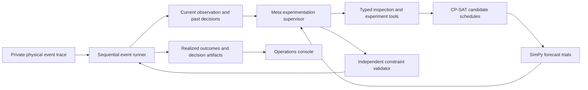

# Factory Recovery Lab

**Simulation-grounded autonomous recovery for manufacturing systems.**

A machine breaks. Delivery commitments become uncertain. Factory Recovery Lab lets a Meta model inspect the current shop, propose bounded recovery experiments, compare simulation evidence, and choose whether to **PERSIST** or **REPLAN**. Production then continues until the next observed update.

Built by Ayushi Chadha for the Meta Global AI Developer Hackathon 2026, **Indie Developer / Push the Frontier**. This is a simulation-based digital twin prototype with synthetic manufacturing data; it is not connected to a physical factory.

[](https://github.com/Ayushichadha/meta-autonomous-lab/actions/workflows/tests.yml)

[Live hosted application](https://ayushichadha--factory-recovery-lab-web.us-east.modal.run/) · [Recorded replay](https://ayushichadha.github.io/meta-autonomous-lab/) · [Validation: multimodal verification and research extensions](docs/VALIDATION_2026-11-04.md)

## What works

- Sequential outages, changing repair estimates, confirmed repairs, and multiple down machines.
- Four machines, eight orders, explicit routing eligibility, precedence, deadlines, priorities, and reroute overhead.
- Queued, blocked, active, paused, and completed operations; interrupted work retains its progress and machine.
- A real Muse Spark 1.3 tool-using supervisor, with experiment/request budgets and explicit failure fallback.
- Independent validation of schedules, including downtime, overlap, progress, and immutable completed work.
- An operations console with observation replay, actual/forecast Gantt segments, queues, hypotheses, tool traces, decisions, and evaluation results.
- Muse Voice Transcribe turns short recorded or uploaded operator audio into review-required text, feeding the same checked recovery workflow.
- The live Meta supervisor can request up to two additional bounded repair-delay stress tests; frozen evaluations retain their original protocol.
- Muse Spark vision reads bounded maintenance images into editable, review-required transcriptions; validated reports feed recovery branches.
- A visible synthetic maintenance board on first load and a factory process diagram reflecting observed machine states.
- Play/pause/restart shift replay, adjustable speed, event highlights and actual worker-progress feedback.
- Maintenance notes interpreted by Meta into quoted claims, independently checked and applied in a separate simulation branch. Missing or ambiguous estimates require clarification.
- Frozen synthetic evaluation: 20 cases per version, four conventional policies, and three predeclared real-Meta cases per version. All outcomes and original failures are published.

## Run the console without spending credits

Requires Python 3.11+ on macOS/Linux. From the repository root:

```bash
python3 -m venv .venv
source .venv/bin/activate
python -m pip install -e '.[dev]'
PYTHONPATH=src python -m factory_lab.cli serve
```

Open **http://127.0.0.1:8765**. The console loads a **recorded real Meta execution** and published evaluation results. Replaying artifacts and executing conventional policies spend no API credits. The original single-event lab remains available at `/single`.

The source-path command also avoids a macOS/Python 3.13 issue where Finder-hidden editable `.pth` files are ignored. `requirements.lock.txt` records the resolved original local environment; `pyproject.toml` defines supported dependency ranges. CI runs the offline suite on Python 3.12.

```bash
python -m pytest
PYTHONPATH=src python -m factory_lab.cli episode --policy solver_selection
```

The latter writes `runs/episode.json` with observations, enacted schedules, candidate forecasts, realized outcomes, compute usage, and failures.

## Spoken reports and research mode

Choose **Replay Meta research run · no API** to inspect the actual verified investigation, including its extra-delay tests.

The maintenance inbox supports a microphone recording or uploaded audio clip up to 20 seconds. **Transcribe with Meta** uses Muse Voice Transcribe; review the resulting text before validating or applying it. For live investigation, select Meta and check **Ask Meta to investigate late-repair risk**. The supervisor can choose bounded extra-delay experiments on tested plans. See [the workflow and protocol distinction](docs/VOICE_AND_RESEARCH.md).

## Image-to-recovery demonstration

On the [live app](https://ayushichadha--factory-recovery-lab-web.us-east.modal.run/), choose **Load synthetic board**, then **Read image with Meta**. Review and correct the transcription, confirm it, and choose **Interpret & validate** before explicitly applying a recovery branch. Image reading and interpretation use credits; conventional recovery and shift playback do not. See [the complete workflow and limits](docs/MULTIMODAL.md).

## Maintenance-note recovery

Choose **Replay verified note · no API** to inspect a recorded real extraction and completed recovery branch. At minute 55, “CNC-A repair delayed by another 40 minutes” changes the previous estimate of 120 to 160, while “INSPECT remains available” causes no state change. The original recording stays intact.

Locally, **Interpret & validate** makes one paid model call; **Apply in new branch** runs the conventional selector without inference, or choose the explicitly paid Meta supervisor. Grounding checks reject invented quotes and unknown machines, and distinguish forecasts from confirmed repairs. These checks do not establish the truth of an external operator report.

## Connect Meta for a new live execution

Copy `.env.example` to `.env` and add a Meta API key locally:

```dotenv
META_API_KEY=your_key_here
META_MODEL=muse-spark-1.3
```

`.env` is ignored by Git. API keys never reach the browser. These commands **use credits**:

```bash
PYTHONPATH=src python -m factory_lab.cli smoke --provider meta
PYTHONPATH=src python -m factory_lab.cli episode --policy meta --output runs/live-episode.json
```

Alternatively select **Meta supervisor · uses API credits** in the console. New executions show actual observation and tool-progress events; completed runs become inspectable observations. There is no silent mock-model replacement.

The primary provider uses the participant's activated Meta API credits. Partner credit applications are pending; Baseten remains an optional unverified provider. Modal and Fireworks integrations are not implemented.

## Architecture and the role of Meta



The model supervises investigation, experiments, and selection. CP-SAT constructs schedules. SimPy executes and measures them. A separate deterministic checker rejects invalid plans. The model cannot create machine capabilities, change processing times, execute arbitrary code, or submit a free-form schedule.

Protocol version 2 precomputes a mandatory preserve baseline, counts it as one of three experiments, and gives the model compact measured evidence. The model can select that baseline immediately or investigate up to two additional actions. Explicit hypotheses and tool requests are retained. The final available model turn is reserved for selecting a tested plan.

The physical runner never restarts a failed machine from an estimate: only a confirmed repair permits execution. Future events and actual repair times are absent from policy observations. The full exogenous trace is released only in the completed artifact. See [the sequential contract](docs/SEQUENTIAL_CONTRACT.md).

## Evaluation and actual findings

All policies share the same shop, initial schedule, exogenous events, observations, constraints, objective weights, per-solve cap, and mandatory feasibility guards. Their actual compute use differs and is reported.

Policies: preserve when feasible; always replan; fixed-interval replanning; a strong conventional selector testing all three candidates; and Meta-supervised selection. Candidate forecasts are separate from realized execution outcomes.

**Version 2 conventional results, all 20 frozen cases:**

| Policy | Realized priority-weighted delay, mean ± population SD (minutes) | Mean optional revisions | Failures/fallbacks |
| --- | ---: | ---: | ---: |
| Preserve | 1105.25 ± 248.85 | 0.00 | 0/20 |
| Always replan | 538.65 ± 147.03 | 3.65 | 0/20 |
| Fixed interval | 576.35 ± 198.40 | 2.85 | 0/20 |
| Solver selection | 538.65 ± 147.03 | 3.65 | 0/20 |

**Paired real-Meta subset, seeds 11000-11002:** Meta completed all three with no fallback. Its mean weighted delay was **550.33**, versus **546.33** for the strong selector. It matched on two cases. On seed 11000 it made two revisions instead of three, with 1755 rather than 2047 minutes of cumulative optional start shifts, but incurred 667 rather than 655 minutes of weighted delay. This is a measured trade-off, **not evidence of superior scheduling**.

Version 1's three Meta cases exhausted the episode request budget and used explicit safe fallback. Those results remain public. The protocol was then revised and evaluated on new, previously unexecuted seeds. We do not relabel the failed original cases or compare unequal populations as if paired.

- [Version 1 results and failures](results/evaluation-v1/summary.json)
- [Version 2 results](results/evaluation-v2/summary.json)
- [Detailed methodology and limitations](docs/EVALUATION.md)
- [Recorded real Meta demo](results/demo/meta-sequential-demo.json)

Each result row links to a gzip-compressed normalized episode artifact. For example, open one with Python's `gzip.open(path, 'rt')`. No raw provider HTTP responses are published.

## Reproduce comparisons

The frozen configurations record seeds, policies, objective weights, and budgets. Artifacts record the source revision and configuration hash. Reusing an output directory from a different revision/configuration is refused.

```bash
# Conventional policies only: no inference credits.
PYTHONPATH=src python -m factory_lab.cli evaluate \
  --config configs/evaluation-v2.json --output runs/new-evaluation

# Adds real inference on only the three predeclared Meta cases; uses credits.
PYTHONPATH=src python -m factory_lab.cli evaluate \
  --config configs/evaluation-v2.json --output runs/new-evaluation --include-meta
```

Historical outputs are reproduced most closely by checking out their recorded source revision. Live model sampling and wall-clock-bounded feasible CP-SAT schedules need not reproduce bit-for-bit.

## Credit controls

The `runs/meta-usage.jsonl` ledger enforces a **$1 local default allowance** and a **$3 hosted total allowance**, shared across model calls on that deployment, including voice transcription. The hosted ledger retains earlier development usage; it was not reset. This is an application guard, **not an account-wide billing limit**. Unknown usage retains a reservation. There are no automatic network retries.

Defaults: 60,000 serialized prompt bytes, 1,024 generated tokens per request, six model requests per decision, twelve per episode, and three candidate experiments per decision. Meta cost estimates use reported token counts and [standard rates](https://dev.meta.ai/docs/pricing-rate-limits) checked November 4, 2026; provider billing is authoritative. The small allowance prevents a large evaluation from consuming the participant's full credit grant.

## Research foundations and new work

Prior research by Ayushi Chadha:

- [When to Re-Plan: Subgoal Persistence in Hierarchical Latent Reasoning](https://arxiv.org/abs/2606.03741), accepted at the ICML 2026 Workshop on Compositional Learning.
- [A Score Is Not a Policy: Measuring the Value of Adaptive Revision](https://arxiv.org/abs/2609.00874), preprint, under review.

These motivate testing persistence and revision against strong fixed strategies. Their latent-reasoning findings do not establish benefits for manufacturing agents.

The factory application, sequential runner, scheduling integration, independent checks, Meta tool loop, evaluation suite, and console are new hackathon work developed in this public repository from October 30, 2026. Existing libraries are used and attributed; prior research is not presented as a new hackathon contribution.

## Limits and next work

Synthetic four-machine instances with known processing durations and exogenous failures are a narrow testbed. There is no industrial validation, sensor synchronization, ERP integration, or physical machine actuation. Stress trials are representative, not probabilistic guarantees. Three live evaluation cases are insufficient to establish general model reliability or superiority. Model-generated rationale is displayed separately from tool-calculated evidence because its narrative can overstate a comparison.

The demo flow is in [docs/DEMO.md](docs/DEMO.md). The live Python backend runs on Modal CPU infrastructure with bounded web/worker containers, detached execution jobs, scale-to-zero, server-side credentials, and a persistent inference guard. Deployment instructions are in [docs/DEPLOYMENT.md](docs/DEPLOYMENT.md). A static public replay is built by `scripts/build_public_demo.py` and deployed through GitHub Pages. It contains only allowlisted synthetic recordings and evaluation data; new simulation and inference require the local application. A recorded submission video remains packaging work.
